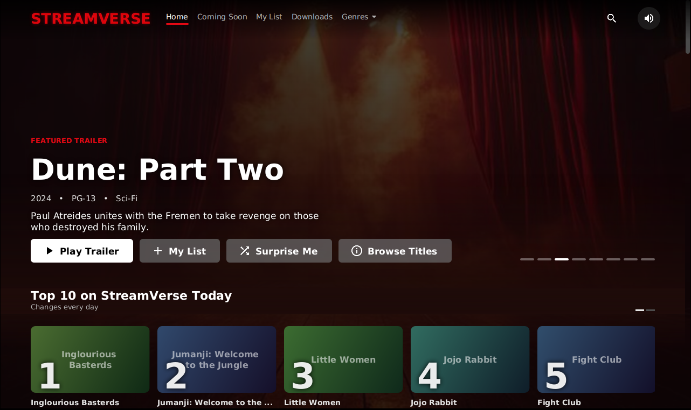
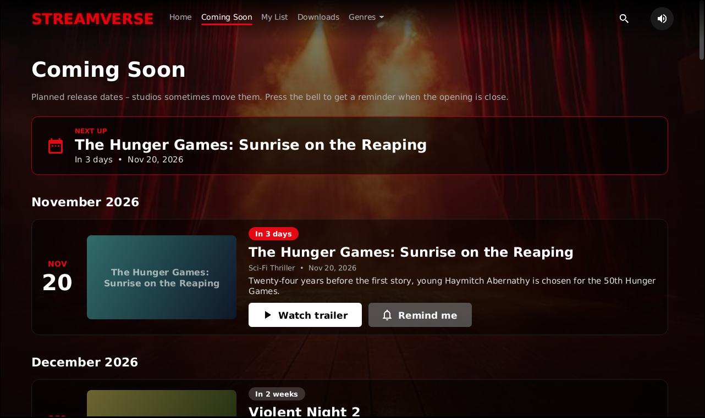
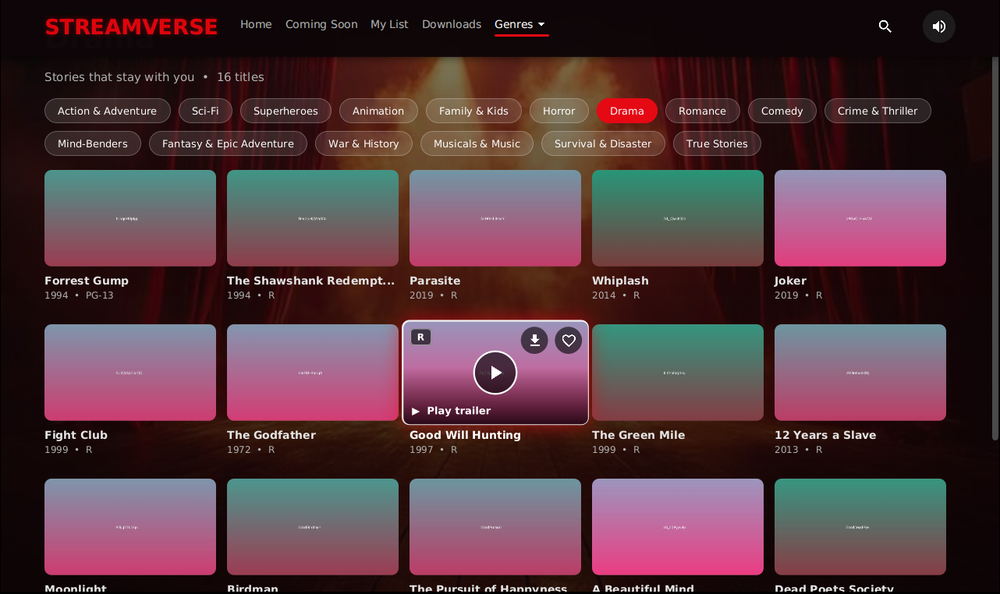
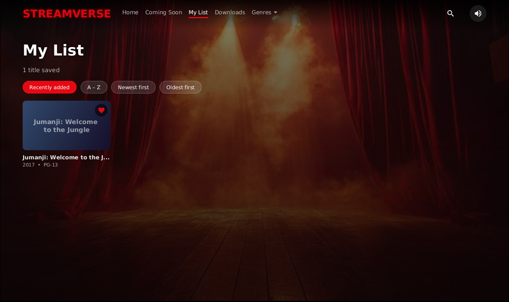
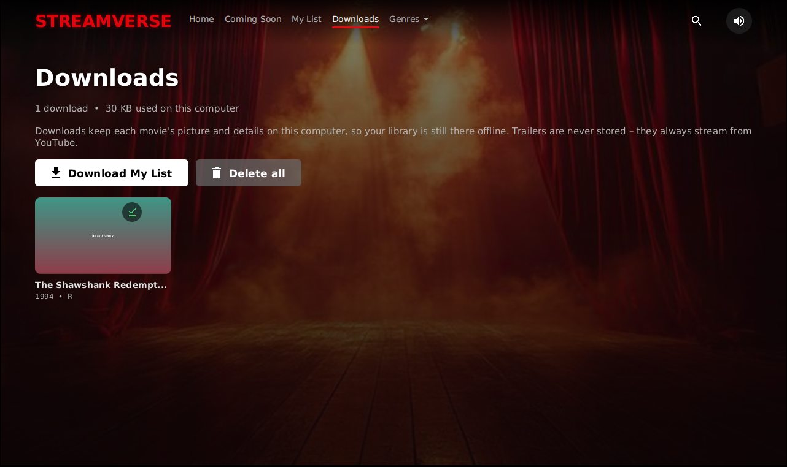
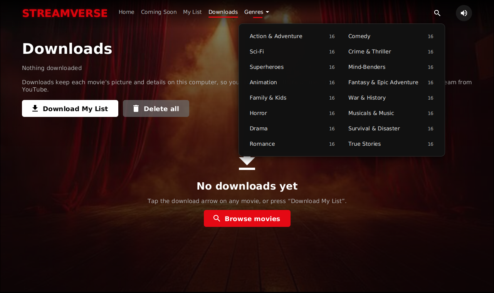

# StreamVerse - JavaFX Movie Trailer Streaming App

Group assignment - B/DIIM3110 Interactive Multimedia - BSc Software Engineering & Multimedia

A Netflix-style desktop app written in **JavaFX**: **165 trailers in 16 genres**, five pages, and the trailer plays **inside the app, streamed from YouTube**
(no video files are stored in the project).

| | |
|---|---|
|  |  |
|  |  |
|  |  |

## 1. Run it
Needs **JDK 17+**, **Maven** and internet.
```bash
mvn javafx:run
```
IntelliJ / VS Code: run **`com.streamverse.Launcher`** (not `App`). More in the troubleshooting table below.

## 2. The pages
| Page | What it does | Code |
|---|---|---|
| **Home** | hero banner, Continue Watching (with progress bars), *Because you watched...*, My List, **Top 10 Today**, Trending, one row per genre, search results, "Surprise Me" | `ui/HomePage` |
| **Genre** | pick any of the 16 genres with chips; all 16 movies of the genre in a grid | `ui/GenrePage` |
| **My List** | everything you hearted; sort by recently added / A-Z / newest / oldest | `ui/MyListPage` |
| **Downloads** | save a movie's picture + details for offline browsing; storage used; *Download My List*, *Delete all* | `ui/DownloadsPage`, `downloads/DownloadService` |
| **Coming Soon** | 20 upcoming films by month, live countdown, "Next up" banner, **Remind me** bell, trailer on demand | `ui/ComingSoonPage` |

> **Downloads never store videos.** The assignment forbids video files in the project and YouTube's terms forbid saving its videos. A download
> saves the movie's *pictures* (card + banner) in `~/.streamverse/downloads/` so it stays in your library without internet; the trailer always streams from YouTube.

## 3. Requirement checklist
| Requirement | Where |
|---|---|
| Click a title/thumbnail -> YouTube trailer inside the app, no video files | `ui/PlayerOverlay` + `player/YouTubePlayerPane` (WebView + YouTube embed served by `player/LocalPlayerServer`) |
| Play / pause | custom play/pause button, seek bar, click on video, **Space**; **rewind / skip 10 s** (buttons, **<- / ->**, **J / L**, double-click the video) |
| Own loading animation | `ui/controls/LoadingAnimation` (film reel, arc, ripples, light sweep, dots) |
| No `Button` class | `ui/controls/CustomButton` = panel + **picture** + text. Pictures are PNG files loaded by URL: `ButtonPictures`, `Buttons`, `Icon` - see `docs/ICON_URLS.md` |
| Sound effects | `audio/SoundManager` (hover, click, navigation, open/close, error) |
| >= 3 categories, >= 8 movies each | 16 genres x 16 movies (`data/SampleMovieRepository`) |
| Only 5 thumbnails visible, scroll for the rest | `ui/CategoryRow` (arrows, Shift+wheel, drag) |
| Hover effect | `ui/MovieCard` |

## 4. Fixes dead trailers by itself (no more "no picture / won't play")
Some YouTube codes were wrong, so those movies had no picture and no video. `net/TrailerResolver` repairs this at run time, with no API key:
1. a picture that fails to load, or a player error (100 / 101 / 150), triggers a check of the code with YouTube's oEmbed endpoint;
2. if the code is dead it searches YouTube for "<title> <year> official trailer", ignores reactions / reviews / clips, and keeps a real, embeddable trailer;
3. the fix is saved in `~/.streamverse/trailer_fixes.txt`; pictures reload and the trailer plays - the player says "Finding a working trailer..." and retries automatically.

The **Repair trailers** button in the Home footer checks all 165 at once. From a terminal: `python tools/verify_trailers.py` and `python tools/fix_trailers.py --apply`.
Coming-soon films have no code at all: their trailer is found the same way when you press **Watch trailer**.

## 5. More features
Resume watching where you stopped - Top 10 Today - Because you watched... - Surprise Me - smart search (`comedy 2009`, `batman`, `PG-13`) - My List and Downloads saved between sessions
- reminders for films opening within a week - rotating hero banner - stage-curtain background - toast messages - lazy picture loading - keyboard shortcuts (Space, <- ->, J L, M, F, N, Esc).

## 6. Code map
```
com.streamverse
 |- App / Launcher            start-up
 |- model/    Movie (key = saved id, videoId = repaired id), Category, Upcoming
 |- data/     MovieRepository, SampleMovieRepository (165 movies), UpcomingCatalogue (20 films)
 |- net/      TrailerResolver            finds working trailers
 |- downloads/DownloadService            saves pictures for offline use
 |- library/  UserLibrary                My List, Continue Watching, Downloads, reminders, progress
 |- player/   LocalPlayerServer, YouTubePlayerPane
 |- audio/    SoundManager
 '- ui/       MainView (page switcher) HomePage GenrePage MyListPage DownloadsPage ComingSoonPage SearchResults
              NavBar GenreMenu HeroBanner CategoryRow MovieCard MovieGrid PlayerOverlay Toast Backdrop Theme ImageCache
     '- controls/  CustomButton Buttons ButtonPictures Icon Chip NavLink SeekBar LoadingAnimation CoverImage
```
Saved data lives in `~/.streamverse/`: `library.txt`, `trailer_fixes.txt`, `downloads/`.

## 7. All pictures and links
`docs/ICON_URLS.md` (button pictures + URLs), `docs/TRAILER_LINKS.md` / `docs/trailer_links.csv` (every movie's code, trailer URL and picture URL).
Team: `docs/GITHUB_SETUP.md`, `docs/GIT_WORKFLOW.md`, `docs/DEFENCE_GUIDE.md`.

## 8. Troubleshooting
| Symptom | Fix |
|---|---|
| `JavaFX runtime components are missing` | run `com.streamverse.Launcher`, or `mvn javafx:run` |
| A movie has no picture / will not play | wait a few seconds (it repairs itself) or press **Repair trailers** in the Home footer; still failing = no internet, or use **Watch on YouTube** |
| "Can't reach YouTube" | check the internet connection / school proxy |
| Download failed | needs internet to fetch the pictures; try again |
| Reset everything | delete the folder `~/.streamverse` |

## 9. Honest status
* Compiles and runs (JDK 21). The pages, My List, downloads, search and the self-repair were exercised end to end against a **stand-in YouTube server** (`tools/fake_youtube_server.py`, which also lets you demo the repair offline).
* The build environment had **no internet**, so real YouTube playback and YouTube's real search-page format could not be tested: test one trailer on your PC early. If YouTube changes its page, the repair falls back to "Watch on YouTube".
* Coming-soon dates were collected in Nov 2026 and may change.
